# Electric Wealth — Knowledge Base

> **Project code:** `electric-wealth`
> **Domain:** Retail wealth-management portal for individual investors: accounts, goals, documents, advisor messaging, market data and financial education
> **KB schema version:** 1.0
> **Last full re-index:** 2026-10-19 (against commit 3f7403e33d97b39872e89690431c7880dea98ae4)
> **Maintained by:** Unassigned — no `framework.user.toml` `[user] name` and no recorded owning team for `api-spring`

This is the root index of the Electric Wealth knowledge base. It is the first file every framework skill reads when it
needs to ground itself in the state of the codebase. [`graph.json`](graph.json) is the machine companion to this
index; both are regenerated from component frontmatter by `build-knowledge-base` / `update-knowledge-base`.

---

## 0. Solution Overview

The KB has two halves: the code-grounded half (this file + `components/` + `graph.json`) and the human-grounded half
under `shared/`. Read these first when grounding a discussion in the solution rather than in the code:

- [`shared/solution-context/00-overview.md`](shared/solution-context/00-overview.md) (pending — run capture-solution-context) — mission, value proposition, classification
- [`shared/solution-context/10-personas-and-use-cases.md`](shared/solution-context/10-personas-and-use-cases.md) (pending — run capture-solution-context) — personas and jobs-to-be-done
- [`shared/solution-context/20-goals-and-kpis.md`](shared/solution-context/20-goals-and-kpis.md) (pending — run capture-solution-context) — goals and KPIs
- [`shared/solution-context/30-constraints-and-compliance.md`](shared/solution-context/30-constraints-and-compliance.md) (pending — run capture-solution-context) — constraints and compliance
- [`shared/solution-context/40-external-integrations.md`](shared/solution-context/40-external-integrations.md) (pending — run capture-solution-context) — vendor catalog
- [`shared/solution-context/50-ownership-and-raci.md`](shared/solution-context/50-ownership-and-raci.md) (pending — run capture-solution-context) — ownership, RACI, on-call
- [`shared/ai-rules/project-context.md`](shared/ai-rules/project-context.md) (pending — run generate-ai-rules) — AI coding rules and architectural must-nots
- [`shared/operations/`](shared/operations/) (pending — run document-operations) — deployment topology, environments, SLOs, runbooks

---

## 1. Solution Summary

Electric Wealth is a retail wealth-management portal for individual investors. Signed-in clients see a portfolio
dashboard, investment accounts (holdings, transactions, performance against a benchmark), documents, savings goals,
notifications, market data with a watchlist, and financial-education content; they manage their profile and
settings and book or message their advisor. Existing branch clients without online access can enrol themselves
through a seven-step registration flow. Everything is bilingual (Canadian English / Canadian French).

The system is three repos in a simple layered style: a React 19 + Vite single-page app (`web`) calls a Spring Boot 4
REST monolith (`api-spring`, the primary repo) that reads and writes a single SQLite file whose schema, migrations and
seed data are owned by `db`. Two decisions shape everything: the committed OpenAPI contract is the integration
backbone (generated from the API code, held at parity with a Node API by tests, and used to generate the web app's
TypeScript types), and the API is a thin controller-plus-SQL layer — no ORM, no service layer, no schema ownership —
with its own bearer-token sessions stored in the shared database.

It is a demo / workshop system: plain-text demo credentials, a fixed MFA code, static market data, stub PDF
documents and share emails that are never sent, no deployment environment, no backups, and no automated tests in the
web and db repos. Out of scope in this workspace: the mobile app and the Node API (`electric-wealth-api`), which share
the contract and the database file but are not indexed here; real market feeds, document storage, email/SMS delivery,
and any external integrations.

---

## 2. Repository Map

| Code | Role | Path | Primary Owner | Last Indexed Commit |
|---|---|---|---|---|
| [`api-spring`](repos/electric-wealth-api-spring/README.md) | api | `{project-root}/../electric-wealth-api-spring` | Not recorded (pending `capture-solution-context`) | `3f7403e33d97b39872e89690431c7880dea98ae4` |
| [`web`](repos/electric-wealth-web/README.md) | ui | `{project-root}/../electric-wealth-web` | Not recorded (pending `capture-solution-context`) | `7489670e43b9b3498218e9a1559254ff6a581ea3` |
| [`db`](repos/electric-wealth-db/README.md) | database | `{project-root}/../electric-wealth-db` | Not recorded (pending `capture-solution-context`) | `e6262fcddca7f4c0488248ca8881483d9b920f0a` |

> Each row corresponds to one `[[project.repos]]` entry in `project.toml`. KB folders use the slug
> `electric-wealth-<code>` (`components/<slug>/`, `repos/<slug>/`, `source-docs/<slug>/`); the `repo` field in
> component frontmatter is the code. `Last Indexed Commit` is the commit the KB was verified against, not the repo's
> current HEAD.

---

## 3. Component Catalog

| Component ID | Repo | Type | Description | Doc |
|---|---|---|---|---|
| `db-identity-and-auth` | `db` | `database-schema` | Use when a change touches the users, user_profiles, user_preferences or sessions tables — logins, demo credentials, profile/address columns, preference flags, or bearer-session rows shared by the Spring and Node APIs. | [doc](components/electric-wealth-db/db-identity-and-auth.md) |
| `db-accounts-and-investments` | `db` | `database-schema` | Use when a change touches investment accounts, holdings, transactions or account performance data — columns, composite (user_id, account_id) keys, money-in-cents conventions or seeded portfolio data. | [doc](components/electric-wealth-db/db-accounts-and-investments.md) |
| `db-documents` | `db` | `database-schema` | Use when a change touches stored client documents or document share records — the documents and document_shares tables, their composite keys, or seeded statements and tax slips. | [doc](components/electric-wealth-db/db-documents.md) |
| `db-goals-and-dashboard` | `db` | `database-schema` | Use when a change touches savings goals or dashboard content tables — goals, portfolio_snapshots, asset_allocations, alerts or quick_links. | [doc](components/electric-wealth-db/db-goals-and-dashboard.md) |
| `db-notifications` | `db` | `database-schema` | Use when a change touches the notifications table — notification types, read flags, ordering or seeded notifications. | [doc](components/electric-wealth-db/db-notifications.md) |
| `db-learning-centre` | `db` | `database-schema` | Use when a change touches education content, per-user learning progress or the bilingual financial glossary tables. | [doc](components/electric-wealth-db/db-learning-centre.md) |
| `db-advisor` | `db` | `database-schema` | Use when a change touches advisors, advisor appointments or secure advisor messages — including the partial unique slot index that prevents double booking. | [doc](components/electric-wealth-db/db-advisor.md) |
| `db-market-data` | `db` | `database-schema` | Use when a change touches static market data or watchlists — securities, price history, news, weekly roundup items, thematic baskets or the per-user watchlist table. | [doc](components/electric-wealth-db/db-market-data.md) |
| `db-online-enrolment` | `db` | `database-schema` | Use when a change touches online enrolment storage — branch client records, security questions, draft registrations, or the security answers saved during and after registration. | [doc](components/electric-wealth-db/db-online-enrolment.md) |
| `db-migration-and-seed-tooling` | `db` | `database-schema` | Use when a change adds or alters a migration, seed file or the Node scripts that build, reset and report on the SQLite database file. | [doc](components/electric-wealth-db/db-migration-and-seed-tooling.md) |
| `api-health` | `api-spring` | `api-feature` | Use when a client, load balancer or developer needs the API liveness check at GET /health. | [doc](components/electric-wealth-api-spring/api-health.md) |
| `api-auth-sessions` | `api-spring` | `api-feature` | Use when a client signs in with email and password, completes the MFA step, refreshes or revokes a bearer session through the /api/auth endpoints. | [doc](components/electric-wealth-api-spring/api-auth-sessions.md) |
| `api-registration` | `api-spring` | `api-feature` | Use when an existing branch client enrols for online access through the multi-step /api/registration flow — login choice, identity match, security questions, optional trusted contact and completion. | [doc](components/electric-wealth-api-spring/api-registration.md) |
| `api-dashboard` | `api-spring` | `api-feature` | Use when the signed-in user's portfolio summary, asset allocation, dashboard goals, action-required alerts or quick links are served by GET /api/wealth/dashboard. | [doc](components/electric-wealth-api-spring/api-dashboard.md) |
| `api-accounts` | `api-spring` | `api-feature` | Use when a client lists, opens, renames or hides investment accounts, or reads account holdings, transactions or performance through /api/wealth/accounts. | [doc](components/electric-wealth-api-spring/api-accounts.md) |
| `api-goals` | `api-spring` | `api-feature` | Use when a client lists or creates savings goals through /api/wealth/goals. | [doc](components/electric-wealth-api-spring/api-goals.md) |
| `api-documents` | `api-spring` | `api-feature` | Use when a client lists, downloads or shares documents through /api/wealth/documents. | [doc](components/electric-wealth-api-spring/api-documents.md) |
| `api-profile-and-preferences` | `api-spring` | `api-feature` | Use when a client reads their profile, replaces their mailing address, or reads or partially updates preferences (theme, language, notification channels, document delivery, default meeting type). | [doc](components/electric-wealth-api-spring/api-profile-and-preferences.md) |
| `api-notifications` | `api-spring` | `api-feature` | Use when a client lists notifications or marks one or all of them as read through /api/notifications. | [doc](components/electric-wealth-api-spring/api-notifications.md) |
| `api-advisor` | `api-spring` | `api-feature` | Use when a client checks advisor availability, books, reschedules or cancels an appointment, or reads and sends secure messages through /api/advisor. | [doc](components/electric-wealth-api-spring/api-advisor.md) |
| `api-education` | `api-spring` | `api-feature` | Use when a client browses the learning catalogue, saves lesson progress or searches the financial glossary through /api/education. | [doc](components/electric-wealth-api-spring/api-education.md) |
| `api-market` | `api-spring` | `api-feature` | Use when a client reads quotes, security detail, price history, search results, news, the weekly roundup or thematic baskets, or adds or removes watchlist symbols through /api/market. | [doc](components/electric-wealth-api-spring/api-market.md) |
| `api-request-pipeline` | `api-spring` | `framework` | Use when a change touches how every API request is authenticated, traced, rate-limited or turned into the standard error envelope — the bearer-token filter, Spring Security config, trace and rate-limit filters, or GlobalExceptionHandler. | [doc](components/electric-wealth-api-spring/api-request-pipeline.md) |
| `api-contract-and-data-access` | `api-spring` | `framework` | Use when a change touches the committed openapi.json contract, OpenAPI generation conventions, shared DTO/enum types, JSON serialisation settings, application configuration, or the JdbcClient row-mapping helpers used by every repository. | [doc](components/electric-wealth-api-spring/api-contract-and-data-access.md) |
| `web-sign-in-and-mfa` | `web` | `ui-feature` | Use when the user signs in on /login with email and password, enters the six-digit MFA code, or sees the idle / expired sign-out notice. | [doc](components/electric-wealth-web/web-sign-in-and-mfa.md) |
| `web-registration-wizard` | `web` | `ui-feature` | Use when a branch client without online access enrols through the seven-step /register wizard (login details, identity, security questions, two-step method, trusted contact, consent, onboarding tour). | [doc](components/electric-wealth-web/web-registration-wizard.md) |
| `web-dashboard` | `web` | `ui-feature` | Use when the signed-in home page (/) shows the portfolio total, day change, action-required alerts, allocation bar, goal progress and quick links — including mapping API deep links to web routes. | [doc](components/electric-wealth-web/web-dashboard.md) |
| `web-accounts` | `web` | `ui-feature` | Use when the user views the accounts list, an account's detail (performance vs benchmark, holdings, transactions, nickname) or opens a new account at /accounts, /accounts/:id or /accounts/new. | [doc](components/electric-wealth-web/web-accounts.md) |
| `web-documents` | `web` | `ui-feature` | Use when the user filters, downloads or shares documents on /documents, including the ?highlight= deep-link row. | [doc](components/electric-wealth-web/web-documents.md) |
| `web-goals` | `web` | `ui-feature` | Use when the user views savings goals or adds a goal on /goals. | [doc](components/electric-wealth-web/web-goals.md) |
| `web-market` | `web` | `ui-feature` | Use when the user searches securities, manages the watchlist, reads news and the weekly roundup, views a security's price chart, or browses thematic baskets at /market, /market/:symbol or /market/baskets. | [doc](components/electric-wealth-web/web-market.md) |
| `web-education` | `web` | `ui-feature` | Use when the user browses lessons by level, marks a lesson complete, or searches the glossary at /learn or /learn/glossary. | [doc](components/electric-wealth-web/web-education.md) |
| `web-advisor` | `web` | `ui-feature` | Use when the user books, reschedules or cancels an advisor meeting, or reads and sends secure messages at /advisor or /advisor/messages. | [doc](components/electric-wealth-web/web-advisor.md) |
| `web-notifications` | `web` | `ui-feature` | Use when the user views the notification centre at /notifications, marks notifications read, or sees the unread badge on the top-bar bell. | [doc](components/electric-wealth-web/web-notifications.md) |
| `web-profile` | `web` | `ui-feature` | Use when the user views personal details, edits the mailing address, or sees the trusted contact on /profile. | [doc](components/electric-wealth-web/web-profile.md) |
| `web-settings` | `web` | `ui-feature` | Use when the user changes theme, language, notification channels, document delivery or default meeting type on /settings. | [doc](components/electric-wealth-web/web-settings.md) |
| `web-app-shell` | `web` | `ui-feature` | Use when a change touches the signed-in / signed-out route tables, the top navigation and user menu, the 404 page, return-to-origin redirects, or how the SPA boots and proxies /api in development. | [doc](components/electric-wealth-web/web-app-shell.md) |
| `web-auth-session` | `web` | `shared-library` | Use when a change touches the browser-side session — AuthContext phases, token storage, the 10-minute refresh timer, idle sign-out, or the global 401 handling that signs the user out. | [doc](components/electric-wealth-web/web-auth-session.md) |
| `web-api-client` | `web` | `shared-library` | Use when a change touches how the web app calls the API — the openapi-fetch client, generated schema.d.ts types, header middleware, ApiError unwrapping, or the TanStack Query hooks and their cache keys. | [doc](components/electric-wealth-web/web-api-client.md) |
| `web-design-system` | `web` | `framework` | Use when a change touches shared UI primitives (cards, buttons, empty/error states, progress bars, pagination), the SVG charts, CSS theme variables, or dark-mode styling. | [doc](components/electric-wealth-web/web-design-system.md) |
| `web-i18n-and-formatting` | `web` | `framework` | Use when a change touches translations (en-CA / fr-CA resource files), locale switching, or money, date and percentage formatting helpers. | [doc](components/electric-wealth-web/web-i18n-and-formatting.md) |

> Description column is in **"Use when …"** form — that phrasing is what skill-routing matches against.

---

## 4. Capability Index

Inverted lookup: **capability → `component_id`s that implement it**. Hit this table first when a story arrives.

| Capability | Component IDs | Owning Repos | Notes |
|---|---|---|---|
| sign in with password and MFA | `web-sign-in-and-mfa`, `web-auth-session`, `api-auth-sessions`, `api-request-pipeline`, `db-identity-and-auth` | `api-spring`, `db`, `web` | Demo MFA code `123456`. |
| refresh or sign out a session | `web-auth-session`, `api-auth-sessions` | `api-spring`, `web` | Refresh every 10 min; idle sign-out after 15 min. |
| enrol a branch client for online access | `web-registration-wizard`, `api-registration`, `db-online-enrolment` | `api-spring`, `db`, `web` | Completion provisions profile, preferences, snapshot, welcome notification, quick links. |
| show the portfolio dashboard | `web-dashboard`, `api-dashboard`, `db-goals-and-dashboard` | `api-spring`, `db`, `web` | Total value computed live from visible account balances. |
| list and view investment accounts | `web-accounts`, `api-accounts`, `db-accounts-and-investments` | `api-spring`, `db`, `web` | Web fetches page 1 only. |
| open a new account | `web-accounts`, `api-accounts`, `db-accounts-and-investments` | `api-spring`, `db`, `web` | TFSA, RRSP, FHSA, NON_REGISTERED only. |
| rename or hide an account | `web-accounts`, `api-accounts` | `api-spring`, `web` | Web exposes nickname only; `hidden` is API-only. |
| show account performance, holdings and transactions | `web-accounts`, `api-accounts`, `db-accounts-and-investments` | `api-spring`, `db`, `web` | Performance `range` is not applied server-side. |
| create and track savings goals | `web-goals`, `api-goals`, `db-goals-and-dashboard` | `api-spring`, `db`, `web` | No update or delete operation. |
| download and share documents | `web-documents`, `api-documents`, `db-documents` | `api-spring`, `db`, `web` | Stub PDF; no email is sent. |
| view profile and edit mailing address | `web-profile`, `api-profile-and-preferences`, `db-identity-and-auth` | `api-spring`, `db`, `web` |  |
| change preferences (theme, language, notifications, delivery, meeting type) | `web-settings`, `web-app-shell`, `api-profile-and-preferences` | `api-spring`, `web` | Top-bar language toggle also saves preferences. |
| read and mark notifications | `web-notifications`, `api-notifications`, `db-notifications` | `api-spring`, `db`, `web` | Polled every 60 s. |
| book, reschedule or cancel advisor meetings | `web-advisor`, `api-advisor`, `db-advisor` | `api-spring`, `db`, `web` | Slot conflicts → 409 `SLOT_UNAVAILABLE`. |
| message the advisor | `web-advisor`, `api-advisor`, `db-advisor` | `api-spring`, `db`, `web` | Client messages only; no polling. |
| browse lessons and track learning progress | `web-education`, `api-education`, `db-learning-centre` | `api-spring`, `db`, `web` |  |
| search the financial glossary | `web-education`, `api-education`, `db-learning-centre` | `api-spring`, `db`, `web` | Locale-aware sorting in Java. |
| search securities and view price history | `web-market`, `api-market`, `db-market-data` | `api-spring`, `db`, `web` | Static demo data. |
| manage the watchlist | `web-market`, `api-market`, `db-market-data` | `api-spring`, `db`, `web` |  |
| read market news, weekly roundup and baskets | `web-market`, `api-market`, `db-market-data` | `api-spring`, `db`, `web` |  |
| map API deep links to web routes | `web-dashboard` | `web` | `electricwealth://…` → routes; unmapped = "Mobile app only". |
| route and lay out signed-in and signed-out pages | `web-app-shell` | `web` | No per-route guards; structural protection. |
| translate the UI and format money and dates | `web-i18n-and-formatting` | `web` | en-CA / fr-CA. |
| render shared UI components and charts | `web-design-system` | `web` | No component or chart library. |
| call the API with typed hooks | `web-api-client` | `web` |  |
| authenticate, trace and rate-limit API requests | `api-request-pipeline` | `api-spring` | 300 req/min/IP. |
| return the standard error envelope | `api-request-pipeline` | `api-spring` |  |
| publish and verify the OpenAPI contract | `api-contract-and-data-access`, `web-api-client` | `api-spring`, `web` | Parity with the Node API. |
| map SQL rows and page results | `api-contract-and-data-access` | `api-spring` |  |
| check API liveness | `api-health` | `api-spring` | Not used by the web app. |
| migrate, seed or reset the database | `db-migration-and-seed-tooling` | `db` | Only path for DDL changes. |

> Capability strings are curated short verb-phrases, not auto-derived from `triggers`. Cross-cutting concerns are in
> § 6 and data entities under [`shared/entities/`](shared/entities/). Never add a capability no component implements.

---

## 5. Dependency Graph

Rendered from [`graph.json`](graph.json) (41 nodes, 112 edges). Solid arrows =
`calls`, dotted = `depends-on`, thick = `derives-from`, dashed = `consumes` (the last two have no edges today).

```mermaid
flowchart LR
  subgraph api_spring["electric-wealth-api-spring"]
    api_health["api-health"]
    api_auth_sessions["api-auth-sessions"]
    api_registration["api-registration"]
    api_dashboard["api-dashboard"]
    api_accounts["api-accounts"]
    api_goals["api-goals"]
    api_documents["api-documents"]
    api_profile_and_preferences["api-profile-and-preferences"]
    api_notifications["api-notifications"]
    api_advisor["api-advisor"]
    api_education["api-education"]
    api_market["api-market"]
    api_request_pipeline["api-request-pipeline"]
    api_contract_and_data_access["api-contract-and-data-access"]
  end
  subgraph web["electric-wealth-web"]
    web_sign_in_and_mfa["web-sign-in-and-mfa"]
    web_registration_wizard["web-registration-wizard"]
    web_dashboard["web-dashboard"]
    web_accounts["web-accounts"]
    web_documents["web-documents"]
    web_goals["web-goals"]
    web_market["web-market"]
    web_education["web-education"]
    web_advisor["web-advisor"]
    web_notifications["web-notifications"]
    web_profile["web-profile"]
    web_settings["web-settings"]
    web_app_shell["web-app-shell"]
    web_auth_session["web-auth-session"]
    web_api_client["web-api-client"]
    web_design_system["web-design-system"]
    web_i18n_and_formatting["web-i18n-and-formatting"]
  end
  subgraph db["electric-wealth-db"]
    db_identity_and_auth["db-identity-and-auth"]
    db_accounts_and_investments["db-accounts-and-investments"]
    db_documents["db-documents"]
    db_goals_and_dashboard["db-goals-and-dashboard"]
    db_notifications["db-notifications"]
    db_learning_centre["db-learning-centre"]
    db_advisor["db-advisor"]
    db_market_data["db-market-data"]
    db_online_enrolment["db-online-enrolment"]
    db_migration_and_seed_tooling["db-migration-and-seed-tooling"]
  end
  db_identity_and_auth -.->|depends-on| db_advisor
  db_accounts_and_investments -.->|depends-on| db_identity_and_auth
  db_documents -.->|depends-on| db_identity_and_auth
  db_goals_and_dashboard -.->|depends-on| db_identity_and_auth
  db_notifications -.->|depends-on| db_identity_and_auth
  db_learning_centre -.->|depends-on| db_identity_and_auth
  db_advisor -.->|depends-on| db_identity_and_auth
  db_market_data -.->|depends-on| db_identity_and_auth
  db_online_enrolment -.->|depends-on| db_identity_and_auth
  db_online_enrolment -.->|depends-on| db_advisor
  api_health -.->|depends-on| api_request_pipeline
  api_health -.->|depends-on| api_contract_and_data_access
  api_auth_sessions -->|calls| db_identity_and_auth
  api_auth_sessions -.->|depends-on| api_request_pipeline
  api_auth_sessions -.->|depends-on| api_contract_and_data_access
  api_registration -.->|depends-on| api_auth_sessions
  api_registration -->|calls| db_online_enrolment
  api_registration -->|calls| db_identity_and_auth
  api_registration -->|calls| db_goals_and_dashboard
  api_registration -->|calls| db_notifications
  api_registration -.->|depends-on| api_request_pipeline
  api_registration -.->|depends-on| api_contract_and_data_access
  api_dashboard -->|calls| db_goals_and_dashboard
  api_dashboard -->|calls| db_accounts_and_investments
  api_dashboard -.->|depends-on| api_request_pipeline
  api_dashboard -.->|depends-on| api_contract_and_data_access
  api_accounts -->|calls| db_accounts_and_investments
  api_accounts -.->|depends-on| api_request_pipeline
  api_accounts -.->|depends-on| api_contract_and_data_access
  api_goals -->|calls| db_goals_and_dashboard
  api_goals -.->|depends-on| api_request_pipeline
  api_goals -.->|depends-on| api_contract_and_data_access
  api_documents -->|calls| db_documents
  api_documents -.->|depends-on| api_request_pipeline
  api_documents -.->|depends-on| api_contract_and_data_access
  api_profile_and_preferences -->|calls| db_identity_and_auth
  api_profile_and_preferences -.->|depends-on| api_request_pipeline
  api_profile_and_preferences -.->|depends-on| api_contract_and_data_access
  api_notifications -->|calls| db_notifications
  api_notifications -.->|depends-on| api_request_pipeline
  api_notifications -.->|depends-on| api_contract_and_data_access
  api_advisor -->|calls| db_advisor
  api_advisor -->|calls| db_identity_and_auth
  api_advisor -.->|depends-on| api_request_pipeline
  api_advisor -.->|depends-on| api_contract_and_data_access
  api_education -->|calls| db_learning_centre
  api_education -.->|depends-on| api_request_pipeline
  api_education -.->|depends-on| api_contract_and_data_access
  api_market -->|calls| db_market_data
  api_market -->|calls| db_accounts_and_investments
  api_market -.->|depends-on| api_request_pipeline
  api_market -.->|depends-on| api_contract_and_data_access
  api_request_pipeline -.->|depends-on| api_auth_sessions
  api_request_pipeline -.->|depends-on| api_contract_and_data_access
  web_sign_in_and_mfa -.->|depends-on| web_auth_session
  web_sign_in_and_mfa -->|calls| api_auth_sessions
  web_sign_in_and_mfa -.->|depends-on| web_design_system
  web_sign_in_and_mfa -.->|depends-on| web_i18n_and_formatting
  web_registration_wizard -->|calls| api_registration
  web_registration_wizard -.->|depends-on| web_auth_session
  web_registration_wizard -.->|depends-on| web_api_client
  web_registration_wizard -.->|depends-on| web_design_system
  web_registration_wizard -.->|depends-on| web_i18n_and_formatting
  web_dashboard -->|calls| api_dashboard
  web_dashboard -->|calls| api_profile_and_preferences
  web_dashboard -.->|depends-on| web_api_client
  web_dashboard -.->|depends-on| web_design_system
  web_dashboard -.->|depends-on| web_i18n_and_formatting
  web_accounts -->|calls| api_accounts
  web_accounts -.->|depends-on| web_api_client
  web_accounts -.->|depends-on| web_design_system
  web_accounts -.->|depends-on| web_i18n_and_formatting
  web_documents -->|calls| api_documents
  web_documents -.->|depends-on| web_api_client
  web_documents -.->|depends-on| web_design_system
  web_documents -.->|depends-on| web_i18n_and_formatting
  web_goals -->|calls| api_goals
  web_goals -.->|depends-on| web_api_client
  web_goals -.->|depends-on| web_design_system
  web_goals -.->|depends-on| web_i18n_and_formatting
  web_market -->|calls| api_market
  web_market -.->|depends-on| web_api_client
  web_market -.->|depends-on| web_design_system
  web_market -.->|depends-on| web_i18n_and_formatting
  web_education -->|calls| api_education
  web_education -.->|depends-on| web_api_client
  web_education -.->|depends-on| web_design_system
  web_education -.->|depends-on| web_i18n_and_formatting
  web_advisor -->|calls| api_advisor
  web_advisor -->|calls| api_profile_and_preferences
  web_advisor -.->|depends-on| web_api_client
  web_advisor -.->|depends-on| web_design_system
  web_advisor -.->|depends-on| web_i18n_and_formatting
  web_notifications -->|calls| api_notifications
  web_notifications -.->|depends-on| web_api_client
  web_notifications -.->|depends-on| web_design_system
  web_notifications -.->|depends-on| web_i18n_and_formatting
  web_profile -->|calls| api_profile_and_preferences
  web_profile -.->|depends-on| web_api_client
  web_profile -.->|depends-on| web_design_system
  web_profile -.->|depends-on| web_i18n_and_formatting
  web_settings -->|calls| api_profile_and_preferences
  web_settings -.->|depends-on| web_api_client
  web_settings -.->|depends-on| web_design_system
  web_settings -.->|depends-on| web_i18n_and_formatting
  web_app_shell -.->|depends-on| web_auth_session
  web_app_shell -.->|depends-on| web_api_client
  web_app_shell -.->|depends-on| web_design_system
  web_app_shell -.->|depends-on| web_i18n_and_formatting
  web_auth_session -.->|depends-on| web_api_client
  web_auth_session -.->|depends-on| api_auth_sessions
  web_api_client -.->|depends-on| api_contract_and_data_access
```

**Source of truth:** [`graph.json`](graph.json). This diagram is regenerated from it on every `build-knowledge-base`
/ `update-knowledge-base` run.

---

## 6. Cross-Cutting Concerns

These topics live inside each repo's Part B documentation (under `source-docs/`). The KB indexes them.

| Concern | Owning Repo | Doc Pointer |
|---|---|---|
| Authentication & Authorization | `api-spring` | [`source-docs/electric-wealth-api-spring/api-consumer/02-authentication.md`](source-docs/electric-wealth-api-spring/api-consumer/02-authentication.md) · [pointer page](shared/cross-cutting/authentication-and-authorization.md) |
| Logging & Observability | `api-spring` | [`source-docs/electric-wealth-api-spring/api-consumer/11-error-handling.md`](source-docs/electric-wealth-api-spring/api-consumer/11-error-handling.md) · [pointer page](shared/cross-cutting/logging-and-observability.md) |
| Error handling | `api-spring` | [`source-docs/electric-wealth-api-spring/api-consumer/11-error-handling.md`](source-docs/electric-wealth-api-spring/api-consumer/11-error-handling.md) · [pointer page](shared/cross-cutting/error-handling.md) |
| Security standards | `api-spring` | [`source-docs/electric-wealth-api-spring/api-consumer/02-authentication.md`](source-docs/electric-wealth-api-spring/api-consumer/02-authentication.md) · [pointer page](shared/cross-cutting/security-standards.md) |
| Performance & rate limits | `api-spring` | [`source-docs/electric-wealth-api-spring/api-consumer/10-rate-limits.md`](source-docs/electric-wealth-api-spring/api-consumer/10-rate-limits.md) · [pointer page](shared/cross-cutting/performance-and-rate-limits.md) |
| API versioning & deprecation | `api-spring` | [`source-docs/electric-wealth-api-spring/api-consumer/14-versioning.md`](source-docs/electric-wealth-api-spring/api-consumer/14-versioning.md) · [pointer page](shared/cross-cutting/api-versioning-and-deprecation.md) |

Also indexed: [Localization (i18n)](shared/cross-cutting/localization.md) — owning repo `web`. Named integration
sequences are under [`shared/integration-patterns/`](shared/integration-patterns/).

---

## 7. How To Load This KB (instructions for the AI agent)

1. **Read this `ARCHITECTURE.md` first.** Sections 0–4 give you the shape of the system.
2. **Hit the Capability Index (§ 4) before anything else** when the user gives you a task. Match the user's
   verbs/nouns against the capability strings to narrow to a small set of `component_id`s.
3. **Open `graph.json` next** to compute the blast radius of those components. Walk outgoing edges (`calls`,
   `consumes`, `depends-on`) to see what they touch; walk incoming edges to see what touches them.
4. **Open the specific `components/<repo-slug>/<component_id>.md` files** for the components in scope. Their
   frontmatter tells you `paths`, `data_entities`, `verification_signal`, and how stale they are.
5. **Check freshness.** If `last_verified_against_commit` on a component is older than the corresponding repo's
   `Last Indexed Commit` in § 2 — _or_ older than 30 days as a wall-clock fallback — treat that component's body
   text as suggestive, not authoritative, and verify against the source files directly.
6. **Never fabricate components.** If a capability is needed but no component in § 4 implements it, say so.
7. **Cross-cutting concerns (§ 6) are pointers.** Follow the pointer into the owning repo's Part B docs.

When you finish a feature, `update-knowledge-base` refreshes the components you touched: it updates
`last_feature_id` and bumps `last_verified_against_commit` to the merge commit.

---

## 8. Maintenance Hooks

- `build-knowledge-base` — initial build (this run); regenerates `ARCHITECTURE.md`, `graph.json` and components from RE output.
- `update-knowledge-base` — applies a shipped feature's changes to components, `graph.json` and this index.
- `detect-knowledge-base-drift` — finds source changes the KB has not absorbed.
- `verify-knowledge-base-coverage` — runs the per-component `verification_signal` checks and coverage sweep.
- `navigate-knowledge-base` — selects the minimal component set for a task (read-only).

KB-level changes are logged in [`change-tracker.md`](change-tracker.md). Project vocabulary: [`glossary.md`](glossary.md).
