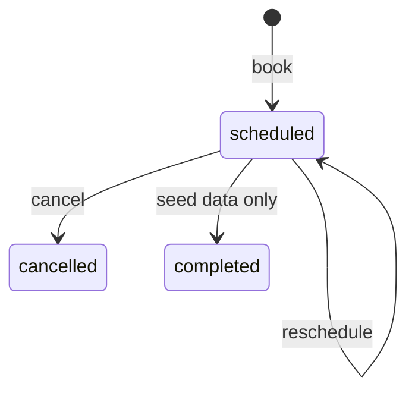

# Entity: Appointment

> **Entity ID:** `appointment`
> **Owning component:** [`api-advisor`](../../components/electric-wealth-api-spring/api-advisor.md)
> **Owning repo:** `api-spring`
> **Source of truth:** schema in [`db-advisor`](../../components/electric-wealth-db/db-advisor.md) ([data dictionary](../../source-docs/electric-wealth-db/data-dictionary.md#appointments)); API shape: `Appointment`, `AppointmentCreateRequest`, `AppointmentPatchRequest`, `AppointmentStatus`, `AvailabilityResponse` in [`openapi.yaml`](../../source-docs/electric-wealth-api-spring/openapi.yaml)
> **Last verified against commit:** `3f7403e33d97b39872e89690431c7880dea98ae4` (`api-spring`), schema `e6262fcddca7f4c0488248ca8881483d9b920f0a` (`db`)

---

## 1. Definition

A meeting between a user and their advisor in a fixed slot (Toronto local date and time) with meeting type, notes and status. Neighbouring entities: [`Advisor`](../../shared/entities/advisor.md), [`UserPreferences`](../../shared/entities/user-preferences.md).

---

## 2. Owning Component

| Field | Value |
|---|---|
| `component_id` | [`api-advisor`](../../components/electric-wealth-api-spring/api-advisor.md) |
| Repo | `api-spring` |
| Why this component owns it | Only writer. |
| Storage location (table / collection / index) | `appointments` in `data/electric-wealth.db` (schema: [`db-advisor`](../../components/electric-wealth-db/db-advisor.md)) |
| Identifier strategy | `appointments`: PK `(id)` — `appt-<8 hex>` |

> The schema is owned by `db-advisor` in the `db` repo. The Spring API
> and the Node API share the same SQLite file, so "owning component" here means the owner of the business rules.
> `direct-read` rows in § 5 are other API components that query this storage through their own SQL.

---

## 3. Fields / Schema

| Field | Type | Required | Source of Truth | Notes |
|---|---|---|---|---|
| `appointments.id` | TEXT | yes | [data dictionary](../../source-docs/electric-wealth-db/data-dictionary.md#appointments) | PK; `appt-<8 hex>` |
| `appointments.user_id` | TEXT | yes | [data dictionary](../../source-docs/electric-wealth-db/data-dictionary.md#appointments) | FK→`users.id` (CASCADE); Client |
| `appointments.advisor_id` | TEXT | yes | [data dictionary](../../source-docs/electric-wealth-db/data-dictionary.md#appointments) | FK→`advisors.id` (NO ACTION) |
| `appointments.meeting_type` | TEXT | yes | [data dictionary](../../source-docs/electric-wealth-db/data-dictionary.md#appointments) | `video` \| `phone` \| `in_person` |
| `appointments.date` | TEXT | yes | [data dictionary](../../source-docs/electric-wealth-db/data-dictionary.md#appointments) | `YYYY-MM-DD` (Toronto) |
| `appointments.time` | TEXT | yes | [data dictionary](../../source-docs/electric-wealth-db/data-dictionary.md#appointments) | `HH:MM` (Toronto) |
| `appointments.status` | TEXT | yes | [data dictionary](../../source-docs/electric-wealth-db/data-dictionary.md#appointments) | `scheduled` \| `completed` \| `cancelled` |
| `appointments.notes` | TEXT | no | [data dictionary](../../source-docs/electric-wealth-db/data-dictionary.md#appointments) |  |
| `appointments.created_at` | TEXT | yes | [data dictionary](../../source-docs/electric-wealth-db/data-dictionary.md#appointments) | UTC |

**Invariants:**

- At most one `scheduled` appointment per advisor slot (`ux_appointments_advisor_slot`).
- Only `scheduled` appointments can change.

**Validation hooks:**

- Partial unique index
- `AdvisorController` slot checks

---

## 4. Lifecycle

| Stage | Action | Performed By | Trigger | Resulting State |
|---|---|---|---|---|
| Created | Insert `scheduled` appointment | [`api-advisor`](../../components/electric-wealth-api-spring/api-advisor.md) | `POST /api/advisor/appointments` | Scheduled |
| Updated | Reschedule (date/time) or cancel (`status = 'cancelled'`) | [`api-advisor`](../../components/electric-wealth-api-spring/api-advisor.md) | `PATCH /api/advisor/appointments/{id}` | Rescheduled or Cancelled |
| Archived / Deleted | Hard delete via `ON DELETE CASCADE` from `users` | [`db-identity-and-auth`](../../components/electric-wealth-db/db-identity-and-auth.md) | User row deleted (no API operation does this) | Row removed |
| Restored (if applicable) | — | — | — | — |

**State transitions:**

---

## 5. Used By

| Component ID | Repo | Access Mode | Why It Reads This Entity |
|---|---|---|---|
| [`web-advisor`](../../components/electric-wealth-web/web-advisor.md) | `web` | `synchronous-read` | Calls `api-advisor` over HTTP (via `web-api-client`) to render it |

**Cross-references:** components with `Appointment` in `data_entities` — see the Component Catalog in [`ARCHITECTURE.md`](../../ARCHITECTURE.md#3-component-catalog).
