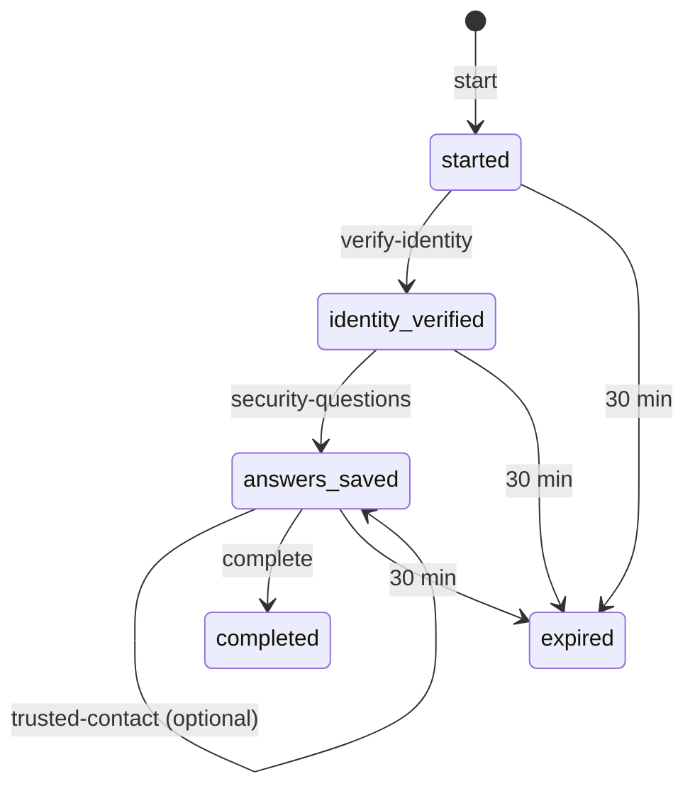

# Entity: Registration

> **Entity ID:** `registration`
> **Owning component:** [`api-registration`](../../components/electric-wealth-api-spring/api-registration.md)
> **Owning repo:** `api-spring`
> **Source of truth:** schema in [`db-online-enrolment`](../../components/electric-wealth-db/db-online-enrolment.md) ([data dictionary](../../source-docs/electric-wealth-db/data-dictionary.md#registrations)); API shape: `RegistrationStartRequest`, `RegistrationStartResponse`, `VerifyIdentityRequest`, `RegistrationCompleteRequest`, `StepSavedResponse` in [`openapi.yaml`](../../source-docs/electric-wealth-api-spring/openapi.yaml)
> **Last verified against commit:** `3f7403e33d97b39872e89690431c7880dea98ae4` (`api-spring`), schema `e6262fcddca7f4c0488248ca8881483d9b920f0a` (`db`)

---

## 1. Definition

A draft online enrolment: chosen email and password, the matched branch account, step flags, MFA method, consent time and the user it produced. Neighbouring entities: [`OfflineClient`](../../shared/entities/offline-client.md), [`SecurityAnswer`](../../shared/entities/security-answer.md).

---

## 2. Owning Component

| Field | Value |
|---|---|
| `component_id` | [`api-registration`](../../components/electric-wealth-api-spring/api-registration.md) |
| Repo | `api-spring` |
| Why this component owns it | Only writer. |
| Storage location (table / collection / index) | `registrations` in `data/electric-wealth.db` (schema: [`db-online-enrolment`](../../components/electric-wealth-db/db-online-enrolment.md)) |
| Identifier strategy | `registrations`: PK `(id)` — `reg-<8 hex>` |

> The schema is owned by `db-online-enrolment` in the `db` repo. The Spring API
> and the Node API share the same SQLite file, so "owning component" here means the owner of the business rules.
> `direct-read` rows in § 5 are other API components that query this storage through their own SQL.

---

## 3. Fields / Schema

| Field | Type | Required | Source of Truth | Notes |
|---|---|---|---|---|
| `registrations.id` | TEXT | yes | [data dictionary](../../source-docs/electric-wealth-db/data-dictionary.md#registrations) | PK; `reg-<8 hex>` |
| `registrations.email` | TEXT | yes | [data dictionary](../../source-docs/electric-wealth-db/data-dictionary.md#registrations) | `COLLATE NOCASE`, **not unique** |
| `registrations.password` | TEXT | yes | [data dictionary](../../source-docs/electric-wealth-db/data-dictionary.md#registrations) | **Demo only, plain text** |
| `registrations.account_number` | TEXT | no | [data dictionary](../../source-docs/electric-wealth-db/data-dictionary.md#registrations) | FK→`offline_clients.account_number` (NO ACTION); Set when identity is verified |
| `registrations.trusted_contact_name` | TEXT | no | [data dictionary](../../source-docs/electric-wealth-db/data-dictionary.md#registrations) |  |
| `registrations.trusted_contact_relationship` | TEXT | no | [data dictionary](../../source-docs/electric-wealth-db/data-dictionary.md#registrations) |  |
| `registrations.trusted_contact_phone` | TEXT | no | [data dictionary](../../source-docs/electric-wealth-db/data-dictionary.md#registrations) |  |
| `registrations.trusted_contact_email` | TEXT | no | [data dictionary](../../source-docs/electric-wealth-db/data-dictionary.md#registrations) |  |
| `registrations.security_answers_saved` | INTEGER | yes | [data dictionary](../../source-docs/electric-wealth-db/data-dictionary.md#registrations) | 0/1 |
| `registrations.mfa_method` | TEXT | no | [data dictionary](../../source-docs/electric-wealth-db/data-dictionary.md#registrations) | `sms` \| `email` |
| `registrations.consented_at` | TEXT | no | [data dictionary](../../source-docs/electric-wealth-db/data-dictionary.md#registrations) |  |
| `registrations.user_id` | TEXT | no | [data dictionary](../../source-docs/electric-wealth-db/data-dictionary.md#registrations) | FK→`users.id` (NO ACTION); Set on completion |
| `registrations.created_at` | TEXT | yes | [data dictionary](../../source-docs/electric-wealth-db/data-dictionary.md#registrations) |  |
| `registrations.expires_at` | TEXT | yes | [data dictionary](../../source-docs/electric-wealth-db/data-dictionary.md#registrations) | Created + 30 min |

**Invariants:**

- Steps must run in order.
- Expires 30 minutes after start; cannot be reused after completion.

**Validation hooks:**

- `RegistrationController` step checks
- `REGISTRATION_TTL`

---

## 4. Lifecycle

| Stage | Action | Performed By | Trigger | Resulting State |
|---|---|---|---|---|
| Created | Insert draft | [`api-registration`](../../components/electric-wealth-api-spring/api-registration.md) | `POST /api/registration/start` | Started, expires in 30 min |
| Updated | Record identity, answers, then completion | [`api-registration`](../../components/electric-wealth-api-spring/api-registration.md) | verify-identity / security-questions / complete | Verified → answers saved → completed |
| Archived / Deleted | Not deleted; expired or completed drafts are unusable | — | — | Closed |
| Restored (if applicable) | — | — | — | — |

**State transitions:**

---

## 5. Used By

| Component ID | Repo | Access Mode | Why It Reads This Entity |
|---|---|---|---|
| [`web-registration-wizard`](../../components/electric-wealth-web/web-registration-wizard.md) | `web` | `synchronous-read` | Calls `api-registration` over HTTP (via `web-api-client`) to render it |

**Cross-references:** components with `Registration` in `data_entities` — see the Component Catalog in [`ARCHITECTURE.md`](../../ARCHITECTURE.md#3-component-catalog).
