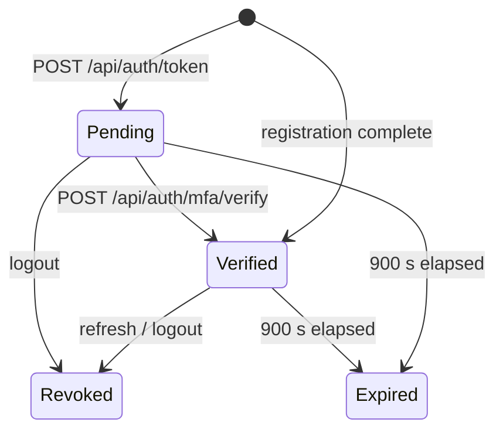

# Entity: Session

> **Entity ID:** `session`
> **Owning component:** [`api-auth-sessions`](../../components/electric-wealth-api-spring/api-auth-sessions.md)
> **Owning repo:** `api-spring`
> **Source of truth:** schema in [`db-identity-and-auth`](../../components/electric-wealth-db/db-identity-and-auth.md) ([data dictionary](../../source-docs/electric-wealth-db/data-dictionary.md#sessions)); API shape: `TokenResponse`, `RefreshResponse`, `MfaVerifyResponse` in [`openapi.yaml`](../../source-docs/electric-wealth-api-spring/openapi.yaml)
> **Last verified against commit:** `3f7403e33d97b39872e89690431c7880dea98ae4` (`api-spring`), schema `e6262fcddca7f4c0488248ca8881483d9b920f0a` (`db`)

---

## 1. Definition

A bearer session: an opaque access/refresh token pair belonging to a user, with MFA status, revocation flag and expiry. Shared with the Node API. Neighbouring entities: [`User`](../../shared/entities/user.md), [`Registration`](../../shared/entities/registration.md).

---

## 2. Owning Component

| Field | Value |
|---|---|
| `component_id` | [`api-auth-sessions`](../../components/electric-wealth-api-spring/api-auth-sessions.md) |
| Repo | `api-spring` |
| Why this component owns it | Issues, verifies, rotates and revokes every session. |
| Storage location (table / collection / index) | `sessions` in `data/electric-wealth.db` (schema: [`db-identity-and-auth`](../../components/electric-wealth-db/db-identity-and-auth.md)) |
| Identifier strategy | `sessions`: PK `(access_token)` — Access token `mock-at-<uuid>` (PK); refresh token `mock-rt-<uuid>` (unique) |

> The schema is owned by `db-identity-and-auth` in the `db` repo. The Spring API
> and the Node API share the same SQLite file, so "owning component" here means the owner of the business rules.
> `direct-read` rows in § 5 are other API components that query this storage through their own SQL.

---

## 3. Fields / Schema

| Field | Type | Required | Source of Truth | Notes |
|---|---|---|---|---|
| `sessions.access_token` | TEXT | yes | [data dictionary](../../source-docs/electric-wealth-db/data-dictionary.md#sessions) | PK; Bearer token `mock-at-<uuid>` |
| `sessions.refresh_token` | TEXT | yes | [data dictionary](../../source-docs/electric-wealth-db/data-dictionary.md#sessions) | UQ; `mock-rt-<uuid>` |
| `sessions.user_id` | TEXT | yes | [data dictionary](../../source-docs/electric-wealth-db/data-dictionary.md#sessions) | FK→`users.id` (CASCADE); Owner (indexed: `ix_sessions_user`) |
| `sessions.mfa_verified` | INTEGER | yes | [data dictionary](../../source-docs/electric-wealth-db/data-dictionary.md#sessions) | 0/1 |
| `sessions.revoked` | INTEGER | yes | [data dictionary](../../source-docs/electric-wealth-db/data-dictionary.md#sessions) | 0/1 |
| `sessions.expires_at` | TEXT | yes | [data dictionary](../../source-docs/electric-wealth-db/data-dictionary.md#sessions) | Now + 900 s (ms precision) |
| `sessions.created_at` | TEXT | yes | [data dictionary](../../source-docs/electric-wealth-db/data-dictionary.md#sessions) | Issue time (ms precision) |

**Invariants:**

- A protected request is accepted only if the token exists, is not revoked, is unexpired and MFA-verified.
- Refresh revokes the previous pair.

**Validation hooks:**

- `BearerTokenFilter`
- `SessionRepository`

---

## 4. Lifecycle

| Stage | Action | Performed By | Trigger | Resulting State |
|---|---|---|---|---|
| Created | Insert token pair (MFA pending, or verified for registration) | [`api-auth-sessions`](../../components/electric-wealth-api-spring/api-auth-sessions.md) | `POST /api/auth/token`, `/refresh`, registration complete | Active, `mfa_verified` 0 or 1, expires in 900 s |
| Updated | Set `mfa_verified = 1` and extend expiry; or set `revoked = 1` | [`api-auth-sessions`](../../components/electric-wealth-api-spring/api-auth-sessions.md) | `POST /api/auth/mfa/verify`, `/refresh`, `/logout` | Verified or revoked |
| Archived / Deleted | Never deleted (rows accumulate); cascade on user delete | [`db-identity-and-auth`](../../components/electric-wealth-db/db-identity-and-auth.md) | — | Revoked / expired rows remain |
| Restored (if applicable) | — | — | — | — |

**State transitions:**

---

## 5. Used By

| Component ID | Repo | Access Mode | Why It Reads This Entity |
|---|---|---|---|
| [`api-registration`](../../components/electric-wealth-api-spring/api-registration.md) | `api-spring` | `direct-read` | Reads or writes the same tables through its own repository SQL (shared SQLite file, no service boundary) |
| [`api-request-pipeline`](../../components/electric-wealth-api-spring/api-request-pipeline.md) | `api-spring` | `direct-read` | Reads or writes the same tables through its own repository SQL (shared SQLite file, no service boundary) |
| [`web-auth-session`](../../components/electric-wealth-web/web-auth-session.md) | `web` | `synchronous-read` | Calls `api-auth-sessions` over HTTP (via `web-api-client`) to render it |
| [`web-sign-in-and-mfa`](../../components/electric-wealth-web/web-sign-in-and-mfa.md) | `web` | `synchronous-read` | Calls `api-auth-sessions` over HTTP (via `web-api-client`) to render it |

**Cross-references:** components with `Session` in `data_entities` — see the Component Catalog in [`ARCHITECTURE.md`](../../ARCHITECTURE.md#3-component-catalog).
