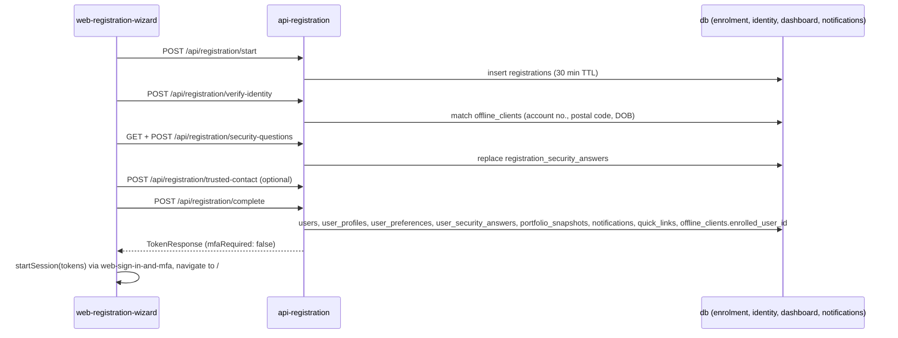

# Integration pattern: Online Enrolment (Registration)

> **Source:** [`source-docs/electric-wealth-api-spring/api-consumer/05-endpoint-detail-template.md`](../../source-docs/electric-wealth-api-spring/api-consumer/05-endpoint-detail-template.md) (Part B)

**Participating components:** [`web-registration-wizard`](../../components/electric-wealth-web/web-registration-wizard.md), [`web-sign-in-and-mfa`](../../components/electric-wealth-web/web-sign-in-and-mfa.md), [`api-registration`](../../components/electric-wealth-api-spring/api-registration.md), [`api-auth-sessions`](../../components/electric-wealth-api-spring/api-auth-sessions.md), [`db-online-enrolment`](../../components/electric-wealth-db/db-online-enrolment.md), [`db-identity-and-auth`](../../components/electric-wealth-db/db-identity-and-auth.md), [`db-goals-and-dashboard`](../../components/electric-wealth-db/db-goals-and-dashboard.md), [`db-notifications`](../../components/electric-wealth-db/db-notifications.md)

Steps must run in order (`STEP_OUT_OF_ORDER`); an expired or finished draft yields `REGISTRATION_NOT_FOUND`, which resets the wizard to step 1.
