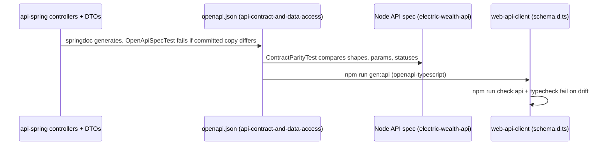

# Integration pattern: OpenAPI Contract Propagation (API → Web types)

> **Source:** [`source-docs/electric-wealth-api-spring/api-consumer/14-versioning.md`](../../source-docs/electric-wealth-api-spring/api-consumer/14-versioning.md) (Part B)

**Participating components:** [`api-contract-and-data-access`](../../components/electric-wealth-api-spring/api-contract-and-data-access.md), [`web-api-client`](../../components/electric-wealth-web/web-api-client.md)

This is the main cross-repo coupling: an API contract change is not done until `schema.d.ts` is regenerated and `npm run verify` passes in the web repo. The KB copy of the contract is `source-docs/electric-wealth-api-spring/openapi.yaml`.
