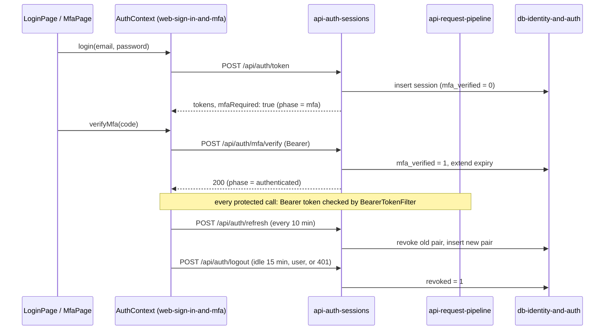

# Integration pattern: Sign-in, MFA and Session Lifecycle

> **Source:** [`source-docs/electric-wealth-api-spring/api-consumer/02-authentication.md`](../../source-docs/electric-wealth-api-spring/api-consumer/02-authentication.md) (Part B)

**Participating components:** [`web-sign-in-and-mfa`](../../components/electric-wealth-web/web-sign-in-and-mfa.md), [`web-api-client`](../../components/electric-wealth-web/web-api-client.md), [`api-auth-sessions`](../../components/electric-wealth-api-spring/api-auth-sessions.md), [`api-request-pipeline`](../../components/electric-wealth-api-spring/api-request-pipeline.md), [`db-identity-and-auth`](../../components/electric-wealth-db/db-identity-and-auth.md)

Sessions live in the shared `sessions` table, so tokens are interchangeable with the Node API. Registration completion skips the MFA step by returning an already verified session (see `online-enrolment`).
