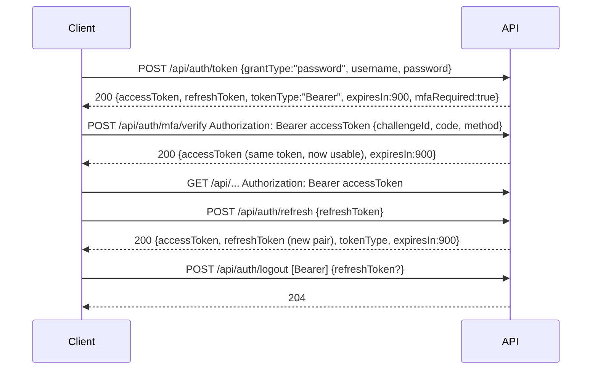

## 2. Authentication

> Demo system: passwords and the MFA code (`123456`) are fixed demo values. Do not reuse this scheme elsewhere.

**Supported auth schemes:**

| Scheme | Where | Used for |
|---|---|---|
| HTTP Bearer (`Authorization: Bearer <accessToken>`) — `bearerAuth` in the spec | Header | Every endpoint under `/api/wealth`, `/api/profile`, `/api/preferences`, `/api/notifications`, `/api/education`, `/api/advisor`, `/api/market`; also `POST /api/auth/mfa/verify` |
| None | — | `/health`, `/api/auth/token`, `/api/auth/refresh`, `/api/auth/logout`, all `/api/registration/*`, `/openapi.json`, `/docs` |

Tokens are opaque strings (`mock-at-…`, `mock-rt-…`); do not parse them.

**Obtaining credentials:**

| Step | Details |
|---|---|
| Sign in | `grantType` must be `password`; `username` is the email. A token from this step is **not** accepted by protected endpoints until MFA succeeds. |
| MFA | Send the step-1 access token as Bearer. `code` must match (demo: `123456`). `challengeId` is required but any string works; `method` must be `sms` or `email`. Success extends the token's life to 900 s from now. |
| Lifetime | Access tokens expire 900 s (15 min) after issue / MFA. Expired tokens get 401. |
| Refresh | Exchange the refresh token for a **new** access + refresh token. The old pair is revoked (reusing it → 401 `INVALID_REFRESH`). The new session keeps its MFA status. |
| Logout | Revokes the Bearer access token and/or the `refreshToken` in the body. Always 204. |
| Enrolment | `POST /api/registration/complete` returns a session that is already MFA-verified (`mfaRequired: false`). |

**Required scopes / audiences:**

None. There are no roles or scopes; a valid, MFA-verified token can call every protected endpoint, and each call
only sees the signed-in user's data.

**Token verification on the server side (informational):**

The API looks the token up in its session store on every request and accepts it if it exists, is not revoked, has
not expired and has completed MFA. Tokens are shared with the Node version of the API (same session store).

**Common 401/403 causes:**

| Code | Cause |
|---|---|
| `UNAUTHORIZED` | Missing/expired/revoked token, or a token that has not completed MFA. Also returned for **any** unknown path under a protected prefix when you are not signed in. |
| `INVALID_CREDENTIALS` | Wrong email or password (same message for both) |
| `INVALID_MFA` | Wrong MFA code |
| `INVALID_REFRESH` | Unknown or already-used/revoked refresh token |

The API never returns 403.

**Secrets handling rules:**

- Keep tokens in memory or secure storage; never log them.
- Refresh proactively before the 900 s expiry, or on a 401 `UNAUTHORIZED` retry once after refreshing.
- Call logout with both the Bearer token and the refresh token to revoke the whole session.
